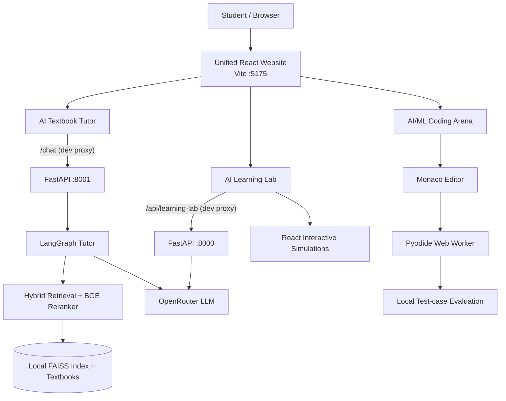
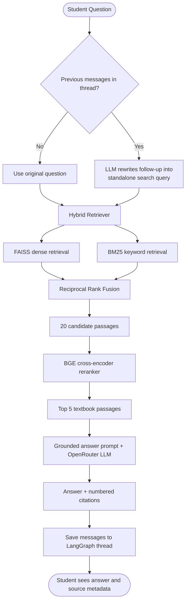
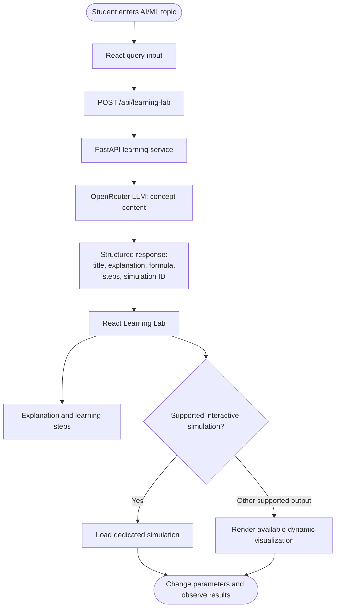
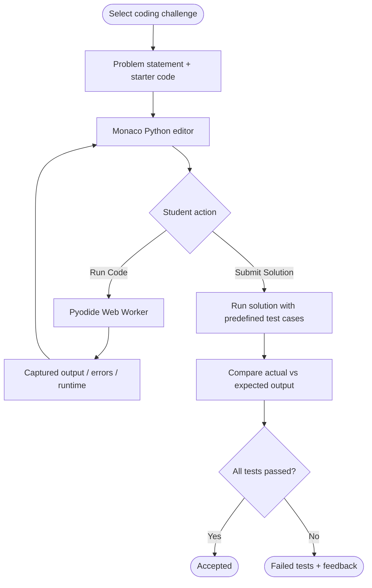
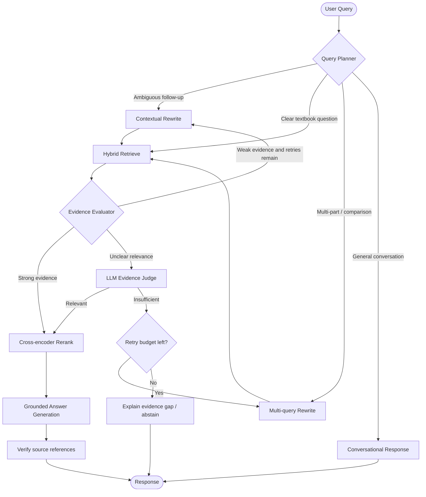
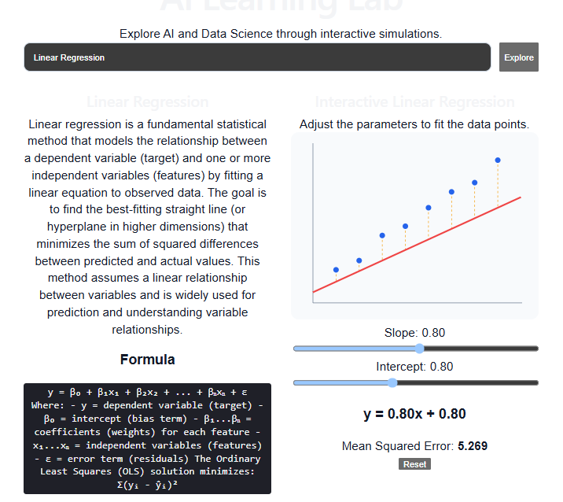
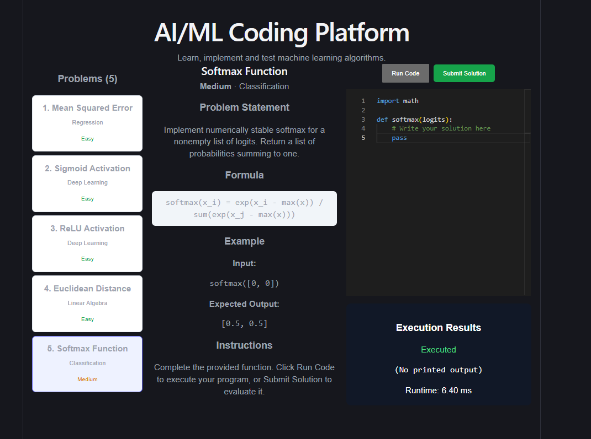

<div align="center">

# Textbook-Chapter-Q-A-Tutor-bot

### Learn the concept. See it in action. Implement it yourself.

**An integrated AI learning environment combining a textbook-grounded conversational tutor, interactive AI/ML simulations, and a browser-based Python coding arena.**

[Overview](#-overview) · [Architecture](#-system-architecture) · [How It Works](#-how-it-works) · [Installation](#-getting-started) · [Screenshots](#-screenshots--results) · [Roadmap](#-roadmap)

**React · TypeScript · Vite · FastAPI · LangChain · LangGraph · FAISS · BGE · Monaco · Pyodide**

</div>

---

## 📌 Overview

Learning artificial intelligence often means jumping between textbooks, explanatory websites, visual demonstrations, and coding environments. **NEURAL** brings those activities into **one website**, organized around three complementary ways of learning:

| Module | What a student does | What powers it |
|---|---|---|
| **AI Textbook Tutor** | Ask questions about AI, receive evidence-grounded explanations, and ask follow-up questions | LangGraph, OpenRouter LLM, hybrid RAG, BGE reranking |
| **AI Learning Lab** | Explore concepts through explanations, formulas, and interactive algorithm simulations | React, FastAPI, LLM-generated explanations, interactive simulations |
| **AI/ML Coding Arena** | Solve AI/ML problems, run Python, and check solutions against test cases | Monaco Editor, Pyodide Web Worker, local test-case grading |

**The aim:** move from **understanding → experimentation → implementation** without switching applications.

> **Project status:** The three modules have been integrated into a single React frontend. The textbook indexing, retrieval/reranking, terminal chatbot, Learning Lab simulations, and standalone Coding Arena have been exercised during development. The unified deployment and its end-to-end flows should still be tested after setup; see [Verification](#-verification-checklist). Some capabilities shown under [Future Advanced RAG Workflow](#-future-advanced-rag-workflow-reference-design) are designs, **not completed features**.

## ✨ Key Features

### 1. AI Textbook Tutor — learn from sources

- Conversational questions and contextual follow-ups: *“What is RAG?” → “How does it reduce hallucinations?”*
- Retrieval from **two AI textbooks**, rather than relying only on the language model's internal knowledge.
- **Hybrid retrieval:** dense similarity search through **FAISS** combined with keyword-based **BM25**.
- **Reciprocal Rank Fusion (RRF)** merges the two ranked result sets.
- **BGE cross-encoder reranking** prioritizes passages most relevant to the question.
- **LangGraph** sequences question rewriting, evidence retrieval, and answer generation.
- Answers are prompted to cite retrieved passages, with their **book title and PDF page** available in the API response.
- **Conversation-thread memory** using LangGraph's in-memory checkpointer (persists only while the backend process runs).

### 2. AI Learning Lab — understand by experimenting

- Enter a concept to receive an explanation, formula, and structured learning steps.
- Explore interactive, parameter-controlled simulations for:
  - Linear Regression
  - Logistic Regression
  - K-Nearest Neighbors (KNN)
  - K-Means Clustering
  - Gradient Descent
  - Overfitting
  - Neural Networks
- Adjust parameters to see how model behavior changes rather than viewing static diagrams.
- The concept response is produced by a FastAPI backend using a configurable OpenRouter model; dedicated simulations run in the React frontend.

### 3. AI/ML Coding Arena — learn by building

- Python editor powered by **Monaco** with syntax highlighting.
- Execute code directly in the browser with **Pyodide**, isolated in a Web Worker.
- **Run Code** for execution feedback; **Submit Solution** to run predefined correctness tests.
- Numerical comparisons support floating-point tolerance.
- Initial problems include **Mean Squared Error, Sigmoid, ReLU, Euclidean Distance, and Softmax**.
- No external paid code-execution API is needed for the current browser-side Python execution.

---

## 🏗 System Architecture

The platform has **one React frontend** and independently maintainable learning modules. During local development, it runs two Python API services and one Vite frontend.



**Why this architecture?** Each module can be developed and tested independently while students access them through the **same website**. The chatbot's retrieval/indexing logic, the Learning Lab's simulations, and the coding engine are not rewritten just to create a common UI.

### Tech stack

| Layer | Technology | Responsibility |
|---|---|---|
| Frontend | React, TypeScript, Vite | Unified dashboard and module navigation |
| Backend APIs | Python, FastAPI, Uvicorn | Chatbot and Learning Lab endpoints |
| Agent orchestration | LangGraph, LangChain | Conversational state and RAG workflow |
| Text embeddings | `BAAI/bge-base-en-v1.5` | Local 768-dimensional dense embeddings |
| Vector search | FAISS | Persistent semantic index |
| Keyword search | `rank-bm25` | Lexical retrieval |
| Reranking | `BAAI/bge-reranker-base` | Cross-encoder relevance ordering |
| LLM generation | OpenRouter (configurable model) | Tutor answers and concept explanations |
| Code editor | Monaco Editor | Python editing experience |
| Python runtime | Pyodide | Browser-side Python execution |
| Conversation state | LangGraph `InMemorySaver` | Follow-up context within a running backend |

---

## 🧠 How It Works

### A. AI Textbook Tutor — conversational, evidence-grounded RAG

The tutor does not immediately send a question to an LLM. It first prepares a search query, retrieves relevant passages, reranks them, and supplies them as evidence for answer generation.



#### How the knowledge base is built

1. **Load PDFs.** `PyPDFLoader` reads the textbooks page by page.
2. **Attach metadata.** Each page retains its book ID, book title, and PDF page number.
3. **Chunk text.** A tokenizer-aware recursive splitter creates overlapping passages (initial configuration: approximately **350 tokens**, **60-token overlap**).
4. **Generate embeddings.** `bge-base-en-v1.5` produces normalized vectors locally.
5. **Persist index.** FAISS saves its index under `chatbot/storage/faiss_index/`.
6. **Reuse it.** Query-time retrieval loads the saved index; full embedding generation is not repeated for every question.

#### What happens when a student asks a question?

| Stage | Action | Why it matters |
|---|---|---|
| **1. Follow-up rewriting** | Resolve ambiguous words like *“it”* using previous chat messages | Makes follow-up queries searchable |
| **2. Dense retrieval** | Find semantically similar textbook passages with FAISS | Captures meaning beyond exact keywords |
| **3. Keyword retrieval** | Search the same passages with BM25 | Helps with technical terms and exact phrases |
| **4. Fusion** | Merge ranked candidates with RRF | Balances dense and lexical matches |
| **5. Reranking** | Score question–passage pairs with a BGE cross-encoder | Reorders results based on the actual question |
| **6. Generation** | Ask the LLM to answer using the top passages | Grounds the explanation in retrieved evidence |
| **7. Conversation update** | Save the new user/assistant messages to the thread | Supports the next follow-up |

**Example conversation**

> **Student:** What is retrieval-augmented generation?  
> **Tutor:** Explains RAG using the retrieved textbook passages and references.  
> **Student:** How does it reduce hallucinations?  
> **Internal rewritten query:** How does retrieval-augmented generation reduce hallucinations in language models?  
> **Tutor:** Retrieves new evidence about RAG and hallucinations before answering.

**Source attribution:** The response includes numbered evidence references such as `[1]` and `[2]`, and the API can return the corresponding **book and PDF page**. These references are **prompt-guided**, not yet independently validated by a citation-checking component.

#### Textbook corpus

The current indexing run used:

| Book | PDF pages | Extraction status |
|---|---:|---|
| *Artificial Intelligence: Foundations of Computational Agents* (third edition) | 904 | Extracted |
| *AI Engineering: Building Applications with Foundation Models* | 535 | Extracted |
| **Total** | **1,439** | **2,951 indexed chunks** |

The reported indexing run produced **2,951 FAISS vectors** from **2,951 chunks**. These are development-run counts and may change if source editions, extraction, or chunk settings change.

> **PDF page vs. printed page:** The stored page number is the **PDF page index + 1**. It may differ from the page number printed inside the book.

### B. AI Learning Lab — explanations plus interactive simulations



The LLM explains the concept and helps select the appropriate visualization; the dedicated simulations perform their own calculations in the frontend. For instance, **Linear Regression** lets a student change **slope** and **intercept** and observe how the fitted line and error respond.

### C. AI/ML Coding Arena — write, execute, evaluate



The execution worker runs **in the browser**, not on the chatbot server. This avoids the need for a hosted Python execution service for the current practice environment.

> **Security and integrity limitation:** This is an **educational, client-side grader**, not a tamper-proof competitive programming judge. Test cases delivered to the browser are inspectable, and arbitrary untrusted code should not be treated as securely sandboxed for high-stakes assessment.

---

## 🔭 RAG Workflow (Reference Design)

The following architecture is inspired by the richer **planner → rewrite → retrieve → evaluate → retry/rerank → generate** flow in the accompanying workflow reference. It is included to explain the **intended next-generation design**. **These extra decision branches are not all implemented in the current chatbot.**



**Current implementation vs. proposed design**

| Capability | Status |
|---|---|
| Question rewriting using conversation history | **Implemented** |
| FAISS + BM25 + RRF | **Implemented** |
| BGE cross-encoder reranking | **Implemented** |
| Grounded answer generation | **Implemented** |
| LangGraph in-process conversation history | **Implemented** |
| Multi-route query planner | Planned |
| Multiple query variants for comparisons | Planned |
| Evidence sufficiency evaluator and bounded retries | Planned |
| LLM evidence judge | Planned |
| Automated citation validation | Planned |
| SQLite-persistent chats across restarts | Planned |
| Retrieval metrics and groundedness benchmark suite | Planned |

**Design principle:** Prefer the local textbooks when answering textbook questions. A future optional web/general-knowledge route should be clearly labeled so students can distinguish **textbook-grounded evidence** from external or model-generated knowledge.

---

## 📁 Project Structure

```text
Textbook-Chapter-Q-A-Tutor-bot-main/
│
├── chatbot/                         # Textbook RAG + LangGraph
│   ├── data/                        # User-provided PDFs (not committed)
│   ├── ingestion/loader.py          # Page-level PDF loading
│   ├── chunking/chunker.py          # Token-aware chunking
│   ├── embeddings/embed.py          # BGE embedding wrapper
│   ├── vector_store/faiss_store.py  # Build and save FAISS index
│   ├── retrieval/
│   │   ├── retriever.py             # FAISS + BM25 + RRF
│   │   └── reranker.py              # BGE cross-encoder
│   ├── graph/
│   │   ├── state.py                 # LangGraph state
│   │   ├── nodes.py                 # Rewrite, retrieve, generate
│   │   └── workflow.py              # Graph edges and checkpointer
│   ├── llm/model.py                 # OpenRouter configuration
│   ├── prompt/prompt_temp.py        # Rewrite and answer prompts
│   ├── api/router.py                # Tutor HTTP API
│   ├── main.py                      # Knowledge-base indexing entry point
│   ├── test_chat.py                 # Terminal chat test
│   └── storage/faiss_index/         # Generated, ignored by Git
│
├── ai_learning_lab/                 # LLM concept lab
│   ├── backend/                     # FastAPI service
│   └── frontend/
│       ├── page.tsx                 # Learning Lab page
│       ├── Explanation.tsx
│       ├── SimulationViewer.tsx
│       └── simulations/             # Interactive models
│
├── AIML_coding_platform/           # Python challenge platform
│   ├── data/problems.json           # Problem bank and test cases
│   ├── backend/                     # Reserved for later backend features
│   └── frontend/
│       ├── page.tsx                 # Coding Arena page
│       ├── CodeEditor.tsx           # Monaco component
│       ├── ProblemList.tsx
│       ├── ProblemDescription.tsx
│       ├── TestResults.tsx
│       ├── executor.ts              # Worker lifecycle / timeout
│       └── python.worker.ts         # Pyodide execution worker
│
├── platform_ui/
│   └── frontend/                    # Single public-facing React UI
│       ├── src/
│       │   ├── App.tsx              # Module navigation
│       │   ├── ChatbotPage.tsx      # Native tutor chat
│       │   ├── App.css
│       │   └── main.tsx
│       ├── vite.config.ts           # Dev proxies to both FastAPI services
│       └── package.json
│
├── .env                             # Local secrets (never commit)
└── .gitignore
```

This tree highlights the important files; the repository may also contain other assets, generated scaffolding, or earlier experimental modules.

---

## 🚀 Getting Started

### Prerequisites

- **Python** with `pip` (the project has been developed on Windows with Python 3.13).
- **Node.js** and **npm** for Vite/React.
- An **OpenRouter API key** for LLM-powered responses.
- Enough disk space and RAM for locally cached BGE models, FAISS, and Pyodide.
- An internet connection for initial package/model downloads and OpenRouter requests.

> The first embedding/reranker launch downloads pretrained weights. Later runs can reuse the local Hugging Face cache.

### 1. Clone and enter the project

```powershell
git clone https://github.com/alobroke/Textbook-Chapter-Q-A-Tutor-bot.git
cd Textbook-Chapter-Q-A-Tutor-bot
```

### 2. Create a Python virtual environment

```powershell
python -m venv .venv
.\.venv\Scripts\Activate.ps1
python -m pip install --upgrade pip
```

If PowerShell blocks the activation script, you can invoke `.venv\Scripts\python.exe` directly for the subsequent commands.

### 3. Install Python dependencies

If the repository has an up-to-date dependency lock or requirements file, use it. Otherwise, the following packages cover the components described here:

```powershell
python -m pip install fastapi "uvicorn[standard]" python-dotenv `
  langchain-community langchain-huggingface langchain-text-splitters `
  langchain-openrouter langgraph sentence-transformers `
  faiss-cpu rank-bm25 pypdf transformers
```

For the local reranker, `sentence-transformers` will also install the required model-runtime dependencies.

### 4. Configure environment variables

Create **`.env` in the repository root**:

```dotenv
OPENROUTER_API_KEY=replace_with_your_key
OPENROUTER_MODEL=nvidia/nemotron-3-ultra-550b-a55b:free

# Model names below document current defaults;
# the initial Python modules use these names directly.
EMBEDDING_MODEL=BAAI/bge-base-en-v1.5
RERANKER_MODEL=BAAI/bge-reranker-base
```

`OPENROUTER_MODEL` is a configurable model identifier. Free models can have changing availability, limits, or access conditions; choose an available OpenRouter chat model if that identifier is unavailable.

**Never commit your `.env` or API keys.**

### 5. Prepare the textbooks

Place the PDFs under `chatbot/data/`. The current `chatbot/ingestion/loader.py` configuration expects the exact names used in its `BOOKS` mapping, including capitalization, spaces, and punctuation. The two filenames used during development were:

```text
chatbot/data/ArtInt3e.pdf
chatbot/data/AI Engineering- Building Applications with Foundation Models -- Chip Huyen -- ( WeLib.org ).pdf
```

**Textbook files are not bundled with this repository.** Obtain content you are authorized to use and update `BOOKS` in `loader.py` if filenames differ. An officially accessible edition of *Artificial Intelligence: Foundations of Computational Agents* is available from [artint.info](https://artint.info/3e/).

### 6. Build the textbook index

Run from the **repository root**:

```powershell
python -m chatbot.main
```

Expected output shape:

```text
=== AI Textbook Indexing ===
Loaded ... pages from ...
Created ... chunks
Loading BGE embedding model...
Creating FAISS index...
FAISS index saved to: .../chatbot/storage/faiss_index
Indexing completed!
```

The generated FAISS index is stored locally. Rebuild it when the books, chunking settings, or embedding model change. Only load saved FAISS data from trusted sources because LangChain's FAISS local loader uses pickle for part of the stored data.

### 7. Start the two Python APIs

Open **two separate terminals**, both at the repository root:

**Terminal A — AI Learning Lab API**

```powershell
python -m uvicorn ai_learning_lab.backend.router:app --host 127.0.0.1 --port 8000
```

**Terminal B — Textbook Tutor API**

```powershell
python -m uvicorn chatbot.api.router:app --host 127.0.0.1 --port 8001
```

Leave both running.

### 8. Start the unified website

In a **third terminal**:

```powershell
cd platform_ui/frontend
npm install
npm run dev
```

Visit **http://localhost:5175/**.

The unified frontend imports the existing Learning Lab and Coding Arena source directly; dependencies used by those modules must also be resolvable in their respective package locations. If you get a missing-package error, install the package declared by the relevant module rather than rewriting that module.

### Local development ports

| URL / endpoint | Service |
|---|---|
| `http://localhost:5175/` | **Unified website** |
| `http://127.0.0.1:8000/docs` | Learning Lab API documentation |
| `http://127.0.0.1:8001/docs` | Chatbot API documentation |
| `POST /api/learning-lab` | Learning Lab request (forwarded by Vite to port 8000) |
| `POST /chat` | Chatbot request (forwarded by Vite to port 8001) |

The original standalone React frontends previously used their own Vite servers; they are **not required as additional frontend servers** for the unified app.

---

## 🔌 API Reference

### AI Textbook Tutor

`POST http://127.0.0.1:8001/chat`

**Example request**

```json
{
  "message": "What is retrieval-augmented generation?",
  "thread_id": "student-session-001"
}
```

**Response shape**

```json
{
  "answer": "<generated textbook-grounded response>",
  "rewritten_query": "What is retrieval-augmented generation?",
  "sources": [
    { "id": 1, "book": "<book title>", "page": 277 }
  ]
}
```

Use the **same `thread_id`** for follow-up questions. Choose a new ID to start another conversation. Current backend memory is **in-process**, not persisted across backend restarts.

### AI Learning Lab

`POST http://127.0.0.1:8000/api/learning-lab`

**Example request**

```json
{ "query": "Linear Regression" }
```

**Response shape**

```json
{
  "title": "Linear Regression",
  "explanation": "<generated explanation>",
  "formula": "<formula>",
  "steps": ["<learning step>"],
  "simulation": "linear_regression",
  "parameters": {}
}
```

The React frontend uses the `simulation` identifier to display the corresponding interactive visualization when available.

---

## 🧪 Verification Checklist

After setup, confirm each subsystem independently and then through the unified UI:

- [ ] **Textbook indexing:** Both books load and the number of FAISS vectors equals the number of indexed chunks.
- [ ] **Retrieval:** Queries return relevant passages with book and PDF-page metadata.
- [ ] **Reranking:** The top passages are more directly relevant than loosely related candidates (inspect manually).
- [ ] **Tutor API:** `POST /chat` returns an answer and a source list.
- [ ] **Follow-up conversation:** A second question such as *“How does it reduce hallucinations?”* is understood in the context of the first.
- [ ] **Learning Lab:** An explanation and an interactive simulation appear for *Linear Regression*.
- [ ] **Coding Arena:** Python executes in Monaco/Pyodide; MSE sample submission passes its tests.
- [ ] **Unified website:** Switching among the three modules works at `localhost:5175`.

### Troubleshooting

| Problem | Likely cause | Suggested check |
|---|---|---|
| `Failed to fetch` in Learning Lab | Backend is offline or proxy is incorrect | Confirm port **8000**, `POST /api/learning-lab`, and Vite proxy |
| `Chat API returned 502` | Chatbot backend unavailable / proxy cannot reach it | Confirm port **8001** and inspect the Uvicorn log |
| `Unexpected end of JSON input` | Response body is empty or invalid | Inspect Network → Response and backend log |
| Missing `ChatbotPage` import | Wrong file location or filename | Check `platform_ui/frontend/src/ChatbotPage.tsx` |
| Pyodide worker format error | Incorrect Vite worker output format | Ensure `worker: { format: "es" }` |
| FAISS index not found | Index not yet generated | Run `python -m chatbot.main` |
| PDF yields empty text | PDF text extraction/stream issue | Validate extracted characters before building the index |
| Hugging Face symlink warning on Windows | Windows cache cannot create symlinks | Usually nonfatal; Developer Mode can enable symlinks |

---

## 📷 Screenshots & Results

> **Screenshot placeholders:** Add your own captures under a directory such as `docs/screenshots/`, then replace the placeholder blocks below with Markdown image links. Avoid putting API keys, personal information, or private chat data in screenshots.


### 1. AI Textbook Tutor — answer with sources


<br>


### 2. AI Learning Lab — interactive Linear Regression





<br>

### 3. AI/ML Coding Arena — accepted solution





<br>


## 📊 Evaluation Strategy

A good AI tutor should not be judged solely by whether its answers *sound* fluent. The intended evaluation plan covers both retrieval and end-to-end response quality.

| Dimension | Example metric / check | Purpose |
|---|---|---|
| Retrieval coverage | Recall@K | Are relevant passages present in the retrieved set? |
| Ranking quality | MRR, nDCG@K | Are useful passages ranked near the top? |
| Reranker improvement | Before/after ranking comparison | Does reranking improve relevance? |
| Answer groundedness | Human review or evidence-based evaluator | Are factual claims supported by sources? |
| Citation accuracy | Citation-to-passage match | Do references point to supporting evidence? |
| Conversational continuity | Follow-up resolution test set | Are ambiguous follow-ups interpreted correctly? |
| Coding correctness | Passed/total predefined tests | Do implementations satisfy the problem specification? |

**Current status:** Retrieval and reranker outputs have been inspected manually, and coding challenges use test-case grading. The full benchmark suite and automatic groundedness/citation checks remain **future work**. Do not interpret raw cross-encoder scores as calibrated probabilities or as measured system accuracy.

---

## 🛣 Roadmap

- [x] Two-textbook PDF extraction and indexing
- [x] Local BGE embeddings and persistent FAISS storage
- [x] BM25 + FAISS hybrid retrieval with RRF
- [x] BGE cross-encoder reranker
- [x] LangGraph question rewriting and grounded answer generation
- [x] In-process conversational context with `thread_id`
- [x] Interactive AI/ML Learning Lab simulations
- [x] Browser-side Coding Arena with Python execution and test-case grading
- [x] Unified React frontend structure with three module views
- [ ] Robust end-to-end integration tests and unified styling
- [ ] Persistent SQLite conversation memory and saved chats
- [ ] Automatic citation verification and evidence sufficiency checks
- [ ] Planner-driven routing, bounded retrieval retries, and comparison queries
- [ ] Heading-aware chunking and textbook/page citation improvements
- [ ] Retrieval benchmark dataset and ablation studies
- [ ] Production deployment, authentication, and operational monitoring

---

## 🔐 Security, Privacy & Limitations

- **API keys:** Keep OpenRouter credentials in the root `.env`, never in the React bundle or Git history.
- **Source files:** Ensure you have permission to use, store, and distribute uploaded textbook material. This repository is intended to store **code**, not redistribute commercial PDFs.
- **Generated indexes:** FAISS files are derived artifacts and are excluded from version control. Regenerate them locally after cloning.
- **Model output:** LLM answers can still be wrong. Citation markers are currently requested through prompting and should be verified for consequential use.
- **Conversation history:** The current LangGraph checkpointer holds conversations **in memory**; restarting the backend clears them. The current local API design does not add user authentication.
- **Execution integrity:** Browser-side Pyodide is suitable for interactive practice, not high-stakes untrusted code grading.
- **Development environment:** Vite's proxy configuration is for local development. A production deployment needs an appropriate reverse proxy/API deployment configuration.


<div align="center">

### **Understand → Visualize → Code**

**One platform. Three complementary learning experiences.**

</div>
